# SOC Mini-Lab: Sysmon + Wazuh

⬅️ [Voltar ao portfólio](../)


## Resumo rápido

| Teste | Técnica | Resultado | Regra |
|---|---|---|---|
| PowerShell Base64 via WMI | T1059.001 + T1047 | Detectado | 92071 (nv 12) |
| Cmdlets ofensivos (Mimikatz, PowerView...) | T1059.001 | Bloqueado pelo Defender + alertado | 62123 (nv 12) |
| Persistência via Run key | T1547.001 | Detectado | 92302 (nv 6) |
| Dump de LSASS (ProcDump) | T1003.001 | Bloqueado pelo Defender + alertado | 62123 (nv 12) |
| SSH brute force (Hydra) | T1110 → T1078 | Detectado em 7 regras encadeadas | 40112 (nv 12) |

**3 achados principais:** lacuna de regra fechada (comandos de reconhecimento sem alerta → 3 regras customizadas), lacuna de coleta diagnosticada (canal do Defender quebrando após reinício forçado, mesmo com agente `Active`) e falso positivo de nível 15 triado e tratado com tuning.

## Sobre o projeto

Laboratório prático de SOC construído do zero, com um endpoint Windows monitorado por Sysmon, um SIEM Wazuh self-hosted e uma VM de ataque (Kali) para simular técnicas reais do MITRE ATT&CK. O objetivo é demonstrar configuração de ambiente, coleta de logs, investigação de eventos de segurança e engenharia de detecção (regras customizadas, tuning e correlação).

Projeto feito na minha transição de Suporte Técnico de TI (9+ anos) para Cibersegurança, com foco em SOC N1.

**Resultados até aqui**

- Pipeline completo funcionando: Sysmon → Wazuh Agent → Manager → Indexer → Dashboard, mais uma VM Kali atacando a rede host-only.
- Encontrei duas **lacunas de detecção** reais, de naturezas diferentes:
  - Lacuna de **regra**: três comandos de reconhecimento (`whoami`, `ipconfig`, `systeminfo`) chegavam ao Manager mas não geravam alerta (sem regra que casasse).
  - Lacuna de **coleta**: o canal do Windows Defender quebrava depois de reinícios forçados da VM (`EvtSubscribe` falhando), fazendo com que bloqueios reais do Defender (Mimikatz, ProcDump) nunca chegassem ao Wazuh — mesmo com o agente marcado como `Active`.
- Simulei 5 testes cobrindo 4 técnicas distintas do MITRE ATT&CK com o Atomic Red Team e um brute force manual (Hydra), com hipótese escrita **antes** de abrir o Wazuh em cada um: T1059.001 (PowerShell, 2 variações do mesmo teste), T1547.001 (persistência via Run key), T1003.001 (dump de LSASS) e T1110 (SSH brute force).
- Escrevi **5 regras customizadas** no Wazuh (3 de detecção, 1 de tuning, 1 de correlação) e validei cada uma com o antes e o depois.
- Triei um alerta de level 15 (regra 92213) e concluí que era falso positivo, com justificativa e proposta de tuning.
- Medi latência real entre evento e alerta em vez de supor: de ~20 s (Defender) a ~63 s (Sysmon/registro), sempre usando o horário UTC do próprio evento para não depender do relógio da VM.
- O caso mais rico do lab foi o brute force SSH: o ruleset **padrão** do Wazuh cobriu o ataque inteiro em 7 regras encadeadas, sem precisar de nenhuma regra customizada.

## Arquitetura

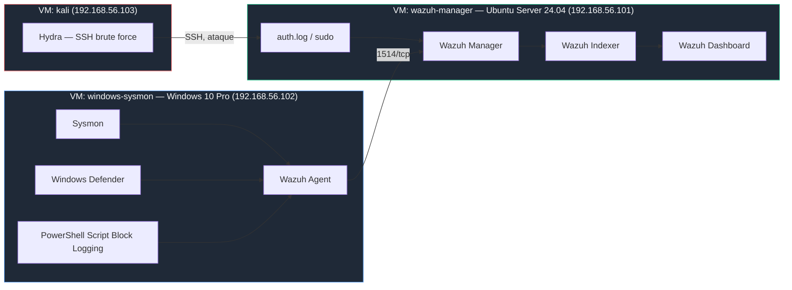

Rede Host-only (VirtualBox) `192.168.56.0/24`.

| Componente | windows-sysmon | wazuh-manager | kali |
|---|---|---|---|
| SO | Windows 10 Pro (EN-US, teclado ABNT2) | Ubuntu Server 24.04.5 LTS | Kali Linux |
| Software | Sysmon (config SwiftOnSecurity), Wazuh Agent 4.14.8, Atomic Red Team | Wazuh 4.14.8 all-in-one (Manager, Indexer, Filebeat, Dashboard) | Hydra |
| RAM | 4 GB | 4 GB | — |
| vCPU | 2 | 2 | — |
| Disco | 50 GB, VDI, alocação dinâmica | 50 GB, VDI, alocação dinâmica | — |
| Rede | Adaptador 1: Host-only / Adaptador 2: NAT | Adaptador 1: NAT / Adaptador 2: Host-only | Host-only |
| Armazenamento no host | SSD (movida do HD, ver Dia 2) | SSD (movida do HD, ver Dia 2) | — |

**Host:** Dell G7, 16 GB RAM, VirtualBox.

## Diário do projeto

### Dia 1: Provisionamento das VMs

#### 1. Planejamento de rede

Cada VM tem dois adaptadores:
- **Host-only:** comunicação entre as VMs (Wazuh Agent → Manager).
- **NAT:** acesso à internet para instalar pacotes e baixar ferramentas.

Inverti de propósito a ordem dos adaptadores entre as duas VMs para me acostumar a conferir sempre os dois.

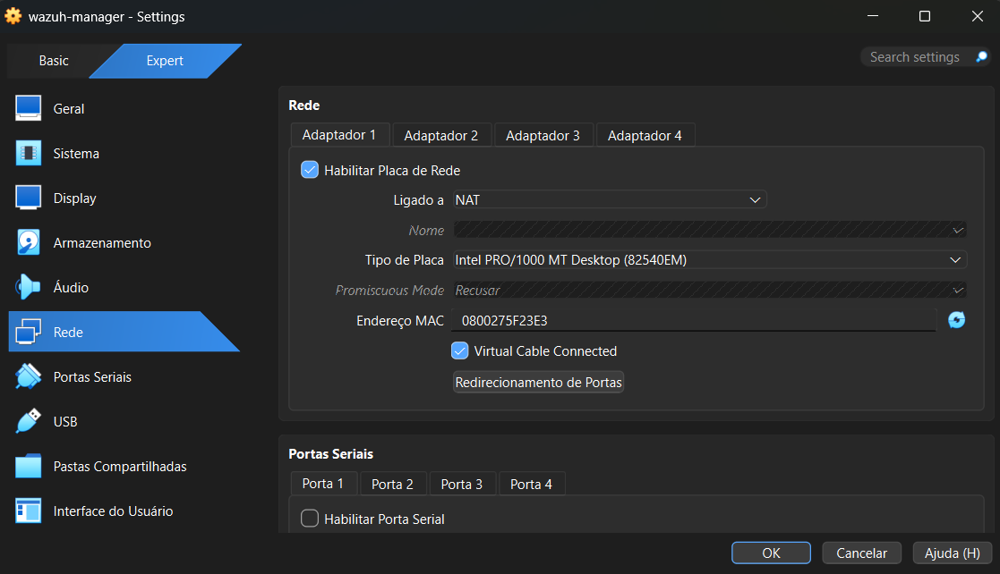
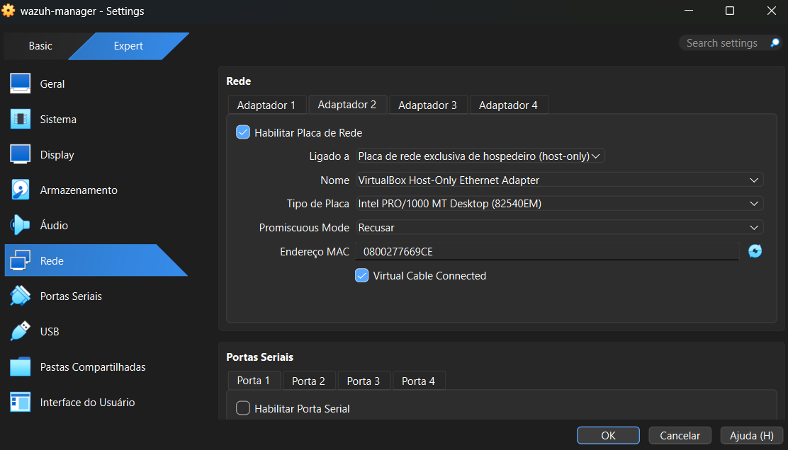
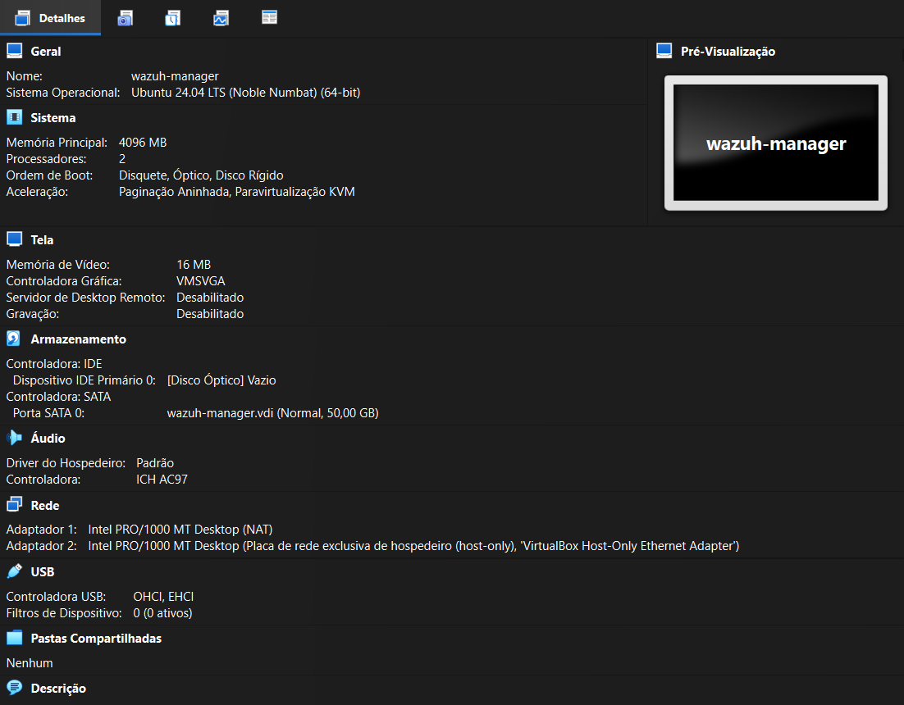

#### 2. Instalação do Ubuntu Server (Wazuh Manager)

- ISO: Ubuntu Server 24.04.5 LTS.
- Instalação padrão (não minimizada), disco inteiro, OpenSSH server habilitado, nenhum snap adicional.
- IP obtido na rede Host-only: `192.168.56.101` (interface `enp0s8`).

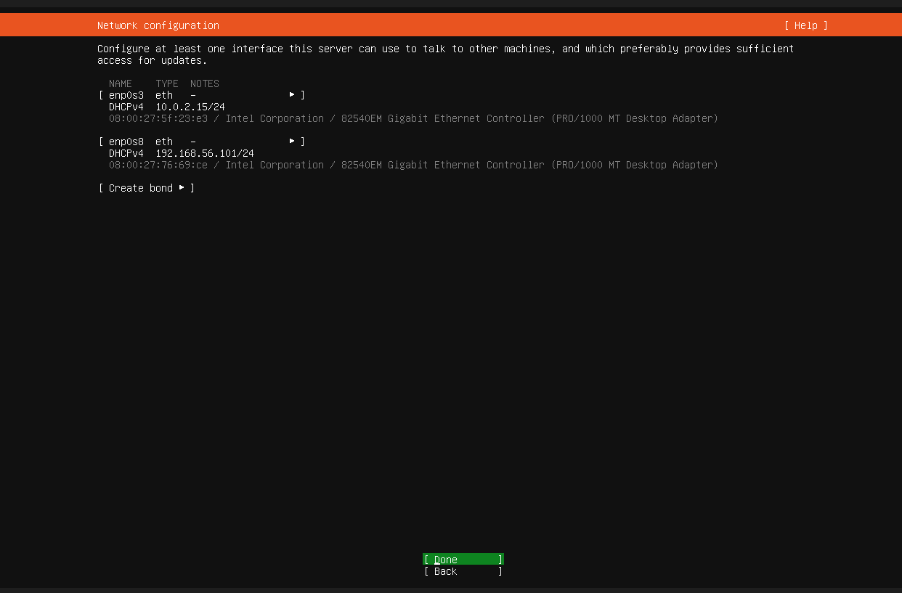
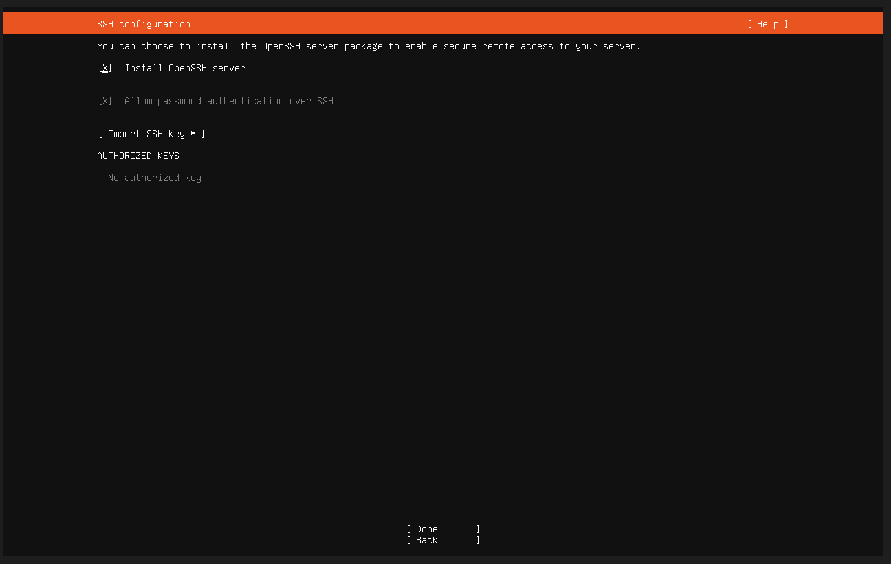
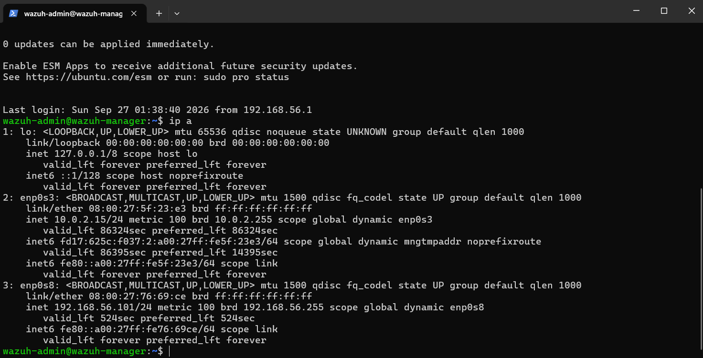

#### 3. Instalação do Windows 10 Pro

- Idioma do sistema em inglês para alinhar interface, logs e documentação das ferramentas (Sysmon, Wazuh, MITRE).
- Guest Additions instalado (resolução automática de tela).

**Problema: instalação travada por mais de 3 horas em "Getting files ready" (50%)**

| Item | Observação |
|---|---|
| Sintoma | Etapa parada em 50% por 3h+, uso de CPU do host em ~12% |
| Verificações | Virtualização (VT-x) habilitada, 300 GB livres no disco, VM consumindo CPU |
| Hipótese | Memória insuficiente na VM, com paging em HD mecânico |
| Teste | Aumentei RAM e vCPU da VM temporariamente |
| Resultado | Instalação foi a 20% em cerca de 2 minutos |
| Conclusão | O gargalo era memória, não processamento: o uso de CPU permaneceu em ~12% mesmo com mais vCPUs, indicando espera por I/O |

Depois da instalação, a VM voltou para 4 GB / 2 vCPU e roda bem nessa configuração.

#### 4. Validação de conectividade

Ping nos dois sentidos entre as VMs, 0% de perda.

- **Windows → Ubuntu:** funcionou de primeira.
- **Ubuntu → Windows:** 100% de perda inicialmente. O Firewall do Windows bloqueia ICMP de entrada por padrão. A rede estava funcional, e o que bloqueava era a regra de firewall. Habilitei a regra *File and Printer Sharing (Echo Request - ICMPv4-In)* e o ping passou.

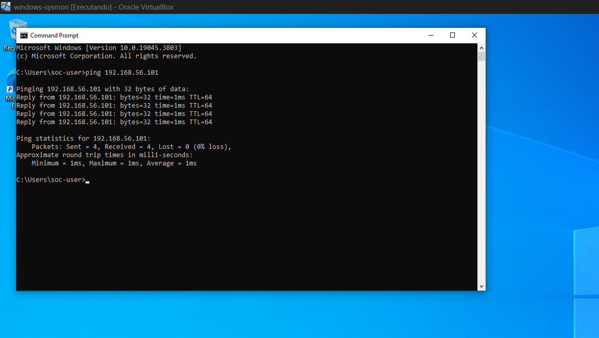
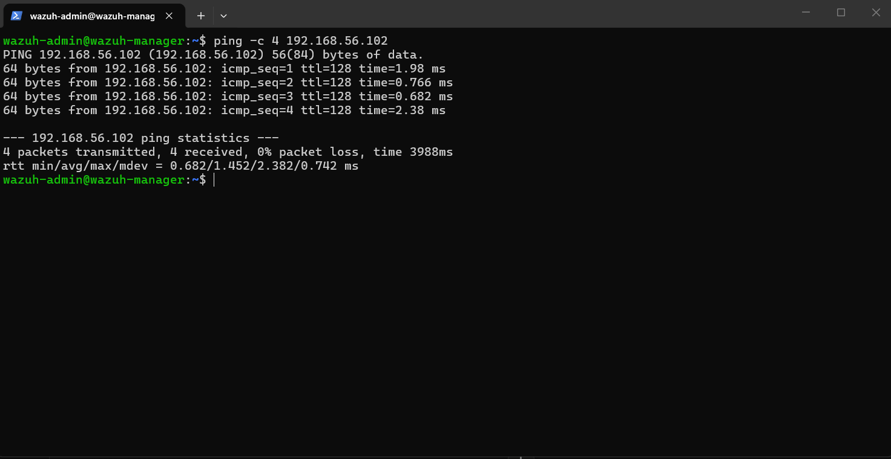

### Dia 2: Wazuh, Sysmon e agente

#### 1. Instalação do Wazuh (all-in-one)

```bash
curl -sO https://packages.wazuh.com/4.14/wazuh-install.sh && sudo bash ./wazuh-install.sh -a
```

**Problema: instalação falhou 1 segundo depois de iniciar o Manager**

| Item | Observação |
|---|---|
| Causa | O `unattended-upgrades` segurava o lock do `dpkg` |
| Correção | Restaurei o snapshot anterior à instalação, esperei o lock ser liberado e reinstalei |
| Aprendizado | Antes de instalar pacotes grandes em Ubuntu recém-criado, conferir se há processos de atualização automática rodando |

O resumo final da instalação também imprimiu a senha do admin em branco. Recuperei do arquivo de instalação:

```bash
sudo tar -O -xvf wazuh-install-files.tar wazuh-install-files/wazuh-passwords.txt
```

Snapshot do Ubuntu com o Wazuh instalado e funcionando: `02-wazuh-instalado-funcionando` (snapshot anterior, `01-ubuntu-limpo-pre-wazuh`, mantido como ponto de retorno limpo).

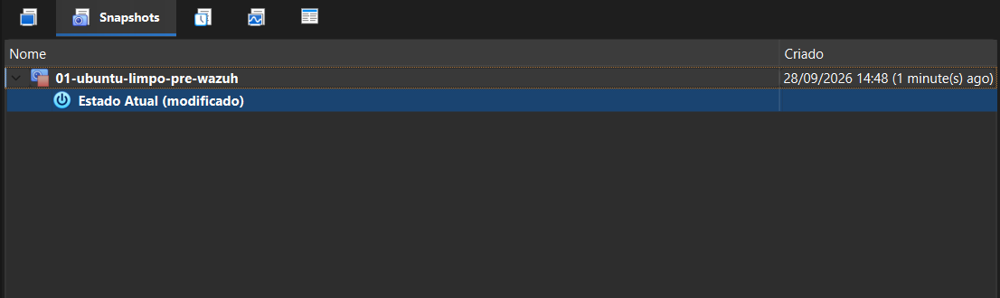
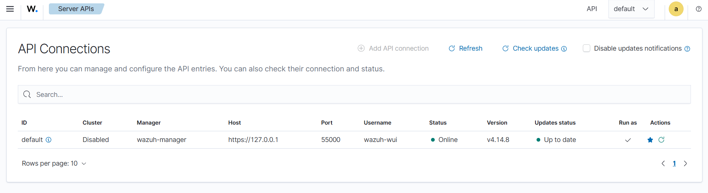

#### 2. Problema: Manager e Indexer estourando o timeout do systemd

| Item | Observação |
|---|---|
| Sintoma | Dashboard com "server is not ready yet" e erros de API; `wazuh-manager` e depois `wazuh-indexer` falhando com timeout de start |
| Efeito colateral | Processos órfãos ficavam rodando depois da falha |
| Limpeza | `systemctl stop`, `wazuh-control stop`, `pkill -f wazuh-indexer`, e start de novo |
| Mitigação | Aumentei o `TimeoutStartSec` com drop-in em `/etc/systemd/system/<serviço>.service.d/timeout.conf` e rodei `daemon-reload` |
| Causa raiz | A VM estava no HD mecânico: o Indexer (Java/OpenSearch) fazia muito I/O ao iniciar |
| Correção definitiva | Movi a VM do Ubuntu para o SSD (VirtualBox: Máquina → Mover). O Indexer passou a iniciar em cerca de 1,5 minuto |

Mesmo padrão do Dia 1: pouca CPU e muita lentidão apontam para I/O, e não para falta de processamento.

#### 3. Sysmon e Wazuh Agent no Windows

Sysmon com a configuração da SwiftOnSecurity:

```powershell
cd C:\Tools\Sysmon
sysmon64.exe -accepteula -i sysmonconfig-export.xml
```

Para o agente ler os eventos do Sysmon, adicionei o bloco abaixo no `ossec.conf` do agente (`C:\Program Files (x86)\ossec-agent\ossec.conf`, antes de `</ossec_config>`):

```xml
<localfile>
  <location>Microsoft-Windows-Sysmon/Operational</location>
  <log_format>eventchannel</log_format>
</localfile>
```

Agente `windows-sysmon` (ID 001, `192.168.56.102`, versão 4.14.8) com status **Active** no Dashboard, e eventos do Sysmon aparecendo no Discover.

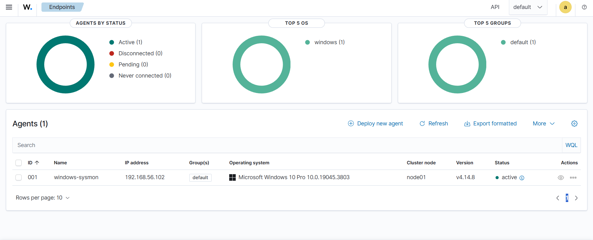

### Dia 3: Engenharia de detecção

#### 1. Eventos controlados e investigação

Rodei comandos conhecidos no PowerShell do Windows e procurei cada um no Discover (`wazuh-alerts-*`).

| Ação | Sysmon logou | Event ID | Wazuh alertou | Regra (level) | MITRE |
|---|---|---|---|---|---|
| `net user` | sim | 1 | **sim** | 92031 (3), 92033 (3) | T1087, T1059.001 |
| `whoami` | sim | 1 | **não** | n/a | T1033 |
| `ipconfig /all` | sim | 1 | **não** | n/a | T1016 |
| `systeminfo` | sim | 1 | **não** | n/a | T1082 |
| criar `teste.bat` (em `Downloads`, via PowerShell) | sim | 11 | **sim** | 92201 (9) | T1105, T1059 |

Dois pontos sobre o `net user`: um comando gera dois eventos (`net.exe` chama o `net1.exe`), e a regra 92033 só disparou quando o comando veio do PowerShell, o que a torna mais específica que a 92031.


#### 2. Achado: lacuna de detecção

O `whoami`, o `ipconfig` e o `systeminfo` não geravam alerta. Antes de concluir que faltava regra, separei as três hipóteses possíveis:

1. O Sysmon não registrou o processo (problema de coleta).
2. O evento não chegou ao Manager (problema de envio do agente).
3. O evento chegou, mas nenhuma regra casou (problema de detecção).

Como eu testei:

- **Hipótese 1:** `Get-WinEvent` no log `Microsoft-Windows-Sysmon/Operational`, em PowerShell como administrador, mostrou o Event ID 1 do `whoami`. O Sysmon registrava.
- **Hipótese 2:** habilitei temporariamente `logall_json` no Manager e acompanhei `/var/ossec/logs/archives/archives.json`. O evento do `whoami.exe` estava lá, decodificado como `windows_eventchannel`, **sem nenhum campo `rule`**. O agente enviava.
- **Conclusão:** o evento chegava e ficava sem regra, por isso nunca entrava no índice `wazuh-alerts-*`, que só guarda eventos que casaram com alguma regra de level 3 ou mais.

Depois do teste desliguei o `logall_json`, reiniciei o Manager e esvaziei o `archives.json`, porque o arquivo cresce rápido e o disco da VM é pequeno. Esse diagnóstico em três passos (verdade local → chegada no Manager → casamento de regra) se tornou o método que usei em todo o resto do lab.

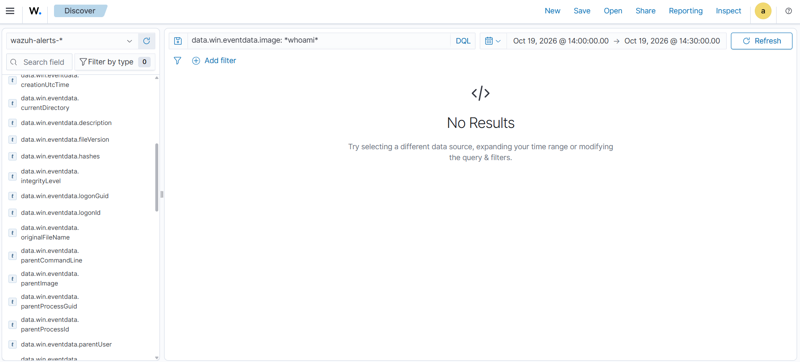

#### 3. Cinco regras customizadas

As regras ficam em `/var/ossec/etc/rules/local_rules.xml`. Fluxo que adotei para cada uma: fazer backup, editar, validar com `wazuh-analysisd -t`, reiniciar o Manager, gerar o evento e conferir no Discover.

| ID | Tipo | O que faz | Level | MITRE |
|---|---|---|---|---|
| 100010 | Detecção | `whoami.exe` executado | 8 | T1033 |
| 100011 | Detecção | `ipconfig.exe` executado | 6 | T1016 |
| 100012 | Detecção | `systeminfo.exe` executado | 6 | T1082 |
| 100013 | Tuning | silencia o falso positivo `__PSScriptPolicyTest_*` da regra 92213 | 0 | n/a |
| 100014 | Correlação | 3 comandos de reconhecimento no mesmo host em 5 min | 12 | T1033, T1016, T1082 |

**Detecção.** Exemplo (100010); as regras 100011 e 100012 seguem o mesmo molde:

```xml
<group name="local,sysmon,windows,discovery,">
  <rule id="100010" level="8">
    <if_group>sysmon_event1</if_group>
    <field name="win.eventdata.image" type="pcre2">(?i)whoami\.exe$</field>
    <description>Discovery: whoami.exe executed (system owner/user discovery)</description>
    <group>recon_cmd,</group>
    <mitre>
      <id>T1033</id>
    </mitre>
  </rule>
</group>
```

Escolhi level 8 para o `whoami` e 6 para `ipconfig` e `systeminfo`, porque o `whoami` isolado é mais raro no dia a dia de um administrador. Usei `$` no fim do padrão do `image` em vez do caminho completo para não depender das barras invertidas do campo.

**Tuning (100013).** Regra filha da 92213 com level 0, que só silencia quando o processo é `powershell.exe` **e** o arquivo segue o padrão `__PSScriptPolicyTest_*.ps1`:

```xml
<group name="local,sysmon,windows,tuning,">
  <rule id="100013" level="0">
    <if_sid>92213</if_sid>
    <field name="win.eventdata.image" type="pcre2">(?i)powershell\.exe$</field>
    <field name="win.eventdata.targetFilename" type="pcre2">(?i)__PSScriptPolicyTest_[a-z0-9]+\.[a-z0-9]+\.ps1$</field>
    <description>Tuning: PowerShell execution policy self-test file (benign), suppresses 92213</description>
  </rule>
</group>
```

Verificação: depois da regra, o Sysmon continuou registrando a criação do arquivo (três eventos às 11:04:39, 11:04:44 e 11:05:57 no relógio da VM) e o Discover ficou sem nenhum alerta 92213 para eles.

Pendência encontrada depois: o mesmo arquivo `__PSScriptPolicyTest_*.ps1` também dispara a regra **92201** (level 9), e a 100013 só filtra filhos da 92213. Na busca por `rule.id: 92201` apareceram 14 ocorrências no período analisado, incluindo o `powershell.exe` de 32 bits (`SysWOW64`) rodando como `NT AUTHORITY\SYSTEM` e criando o arquivo em `C:\Windows\Temp`. Vale uma regra de tuning irmã para a 92201 e checar quem é esse processo SYSTEM antes de silenciá-lo — pendência ainda em aberto.

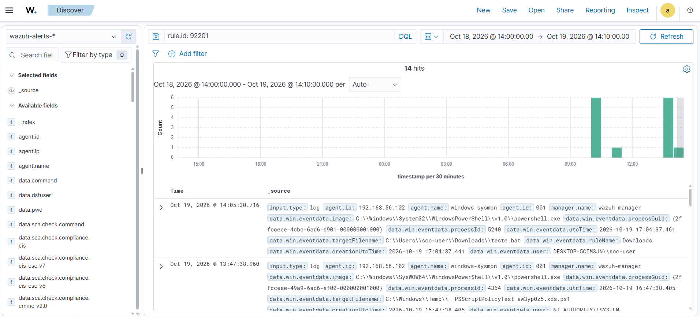

Limitação conhecida: um atacante poderia nomear um arquivo malicioso com esse padrão e executá-lo via `powershell.exe` para escapar da 92213. Exigir os dois campos reduz o risco, mas em produção eu também prenderia o caminho (`AppData\Local\Temp`) na regra. Deixei sem o caminho aqui para não brigar com as barras invertidas.

Confirmação de que a 100013 funcionou: depois dela, a busca por `rule.id: 92213 and data.win.eventdata.targetFilename: *PSScriptPolicyTest*` não retorna mais nenhum alerta, enquanto o `Get-WinEvent` local mostra que o Sysmon continuou registrando a criação desses arquivos normalmente — a regra silenciou o alerta sem esconder o evento de origem.

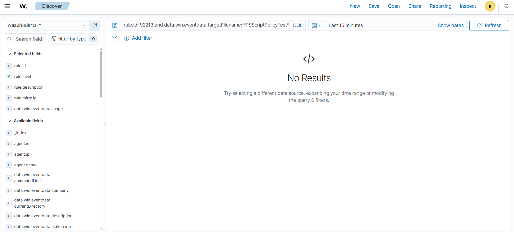
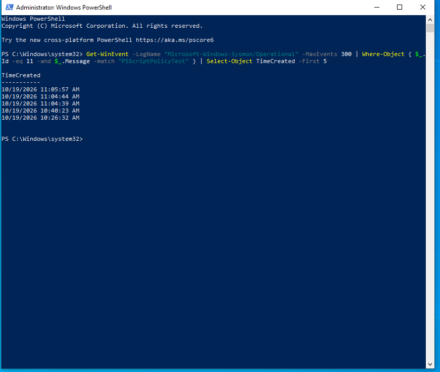

**Correlação (100014).** Dispara quando três eventos do grupo `recon_cmd` aparecem no mesmo computador em 300 segundos:

```xml
<group name="local,sysmon,windows,correlation,">
  <rule id="100014" level="12" frequency="4" timeframe="300">
    <if_matched_group>recon_cmd</if_matched_group>
    <same_field>win.system.computer</same_field>
    <description>Correlation: whoami/ipconfig/systeminfo burst on same host within 5 min (possible host reconnaissance)</description>
    <mitre>
      <id>T1033</id>
      <id>T1016</id>
      <id>T1082</id>
    </mitre>
  </rule>
</group>
```

Um comando isolado é banal, mas os três em sequência no mesmo host sugerem alguém explorando a máquina. Por isso o level 12, bem acima dos 6 e 8 das regras individuais.

**O `frequency` conta um evento a menos.** Com `frequency="3"` a regra disparou com apenas dois comandos. O campo `previous_output` do alerta mostrava um único evento anterior (`whoami`), e o alerta saiu no `ipconfig`. Subi o valor para `4`, e o teste confirmou:

- Dois comandos (`whoami` e `ipconfig`): sem alerta 100014.
- Terceiro comando (`systeminfo`) dentro de 5 minutos: o 100014 disparou, com os dois eventos anteriores no `previous_output` (`eventRecordID` 9011 e 9012, mesmo processo pai `powershell.exe`, a cerca de 4 min 38 s do disparo, dentro do `timeframe` de 300 s).

O evento que completa a regra de frequência vira o alerta 100014 e absorve o alerta individual dele, por isso não aparece um 100012 separado nesse horário.

Limitação: a regra conta eventos do grupo, então o mesmo comando repetido três vezes também dispara. Exigir comandos diferentes fica como melhoria futura.

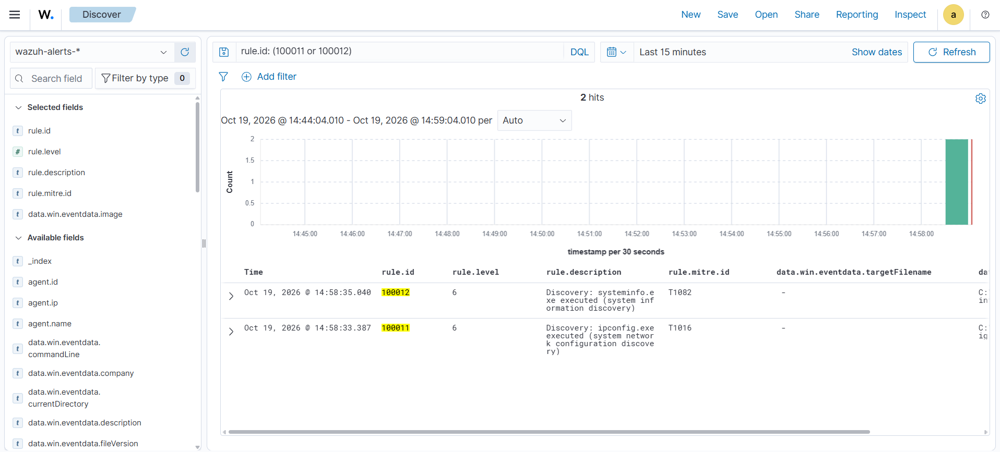

#### 4. Triagem do alerta 92213 (level 15)

Na busca por `data.win.system.eventID: 11` apareceram alertas da regra 92213 ("Executable file dropped in folder commonly used by malware", T1105, level 15). Analisei uma amostra de 10 alertas, que formavam dois grupos.

**Método:** olhei quem criou o arquivo (`image`), o que foi criado e onde (`targetFilename`), o usuário, o horário e se o padrão se repetia.

| Grupo | O que era | Evidência |
|---|---|---|
| 7 alertas | `powershell.exe` criando `__PSScriptPolicyTest_*.ps1` em `AppData\Local\Temp` | Nome com prefixo fixo e sufixo aleatório; horários batem com as vezes em que abri o PowerShell; processo em `System32`; usuário `soc-user` |
| 3 alertas | `msedge.exe` e `msedgewebview2.exe` criando DLLs (`widevinecdm.dll`, `well_known_domains.dll`, `Microsoft.CognitiveServices.Speech.core.dll`) em `Temp\msedge_chrome_Unpacker_...` | Processos do Microsoft Edge em `Program Files (x86)\Microsoft\...`; comportamento de atualização de componentes |

**Nota de triagem**

> **Alerta:** rule.id 92213 (level 15), "Executable file dropped in folder commonly used by malware". **Ativo:** `windows-sysmon`. **Análise:** `powershell.exe` criando `__PSScriptPolicyTest_*.ps1` em Temp e `msedge.exe` criando DLLs de componentes. Ambos são comportamentos nativos (teste da política de execução e atualização do Edge), com processos assinados pela Microsoft e caminhos esperados. **Veredito:** falso positivo. **Escalonamento:** não escalar. **Ação recomendada:** tuning da regra para excluir esses padrões e reduzir o ruído de level 15. O tuning do PowerShell é a regra 100013.

O que um analista ainda verificaria em produção antes de fechar como falso positivo: assinatura digital e hash do executável, processo pai legítimo, e que o binário não esteja em `Temp` ou `Downloads` (mascaramento de nome).

Um level 15 gerando ruído com atividade legítima é um exemplo de alert fatigue. A regra também tem `mail: true`, então dispararia e-mail em produção.


### Dia 4: Atomic Red Team — simulando T1059.001 (PowerShell)

#### 1. Preparação do ambiente de ataque

- Defender: exclusão só da pasta `C:\AtomicRedTeam` (proteção em tempo real continua ligada para o resto do sistema).
- Atomic Red Team instalado com o instalador oficial da Red Canary + `-getAtomics` (22 testes disponíveis para T1059.001).
- Testes escolhidos: #15 (EncodedCommand) e #18 (cmdlets maliciosos conhecidos). Evitados de propósito: #1 e #4 (Mimikatz, ficam para o T1003), #2/#3/#21/#22 (BloodHound/SOAPHound, exigem domínio), #6/#7/#8/#19/#20 (baixam da rede).
- Metodologia adotada para cada teste, repetida do Dia 3: escrever a hipótese **antes** de abrir o Wazuh, provar a "verdade local" no Windows (`Get-WinEvent`), comparar com o Dashboard e separar detectado de lacuna. Alerta ausente não significa evento ausente — o índice `wazuh-alerts-*` só guarda o que casou com regra de nível ≥ 3, então para confirmar a chegada eu ligava `logall_json` (`archives.json`) e depois desligava de novo (o arquivo cresce rápido).
- Antes de rodar os testes, adicionei o canal do Windows Defender ao `ossec.conf` do agente, ao lado dos canais do Sysmon e do PowerShell já configurados:

```xml
<localfile>
  <location>Microsoft-Windows-Windows Defender/Operational</location>
  <log_format>eventchannel</log_format>
</localfile>
```

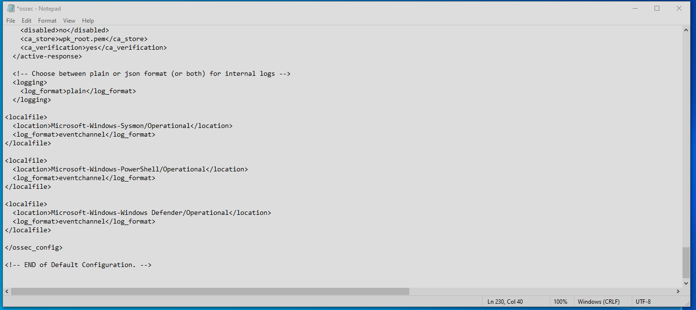

Lista completa dos 22 testes disponíveis para T1059.001 no Atomic Red Team (`-ShowDetailsBrief`), usada para escolher os testes #15 e #18 com critério:

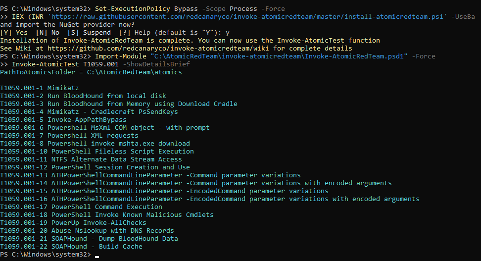

#### 2. #15: EncodedCommand (PowerShell via WMI)

| Campo | Conteúdo |
|---|---|
| Hipótese (escrita **antes** de olhar o Wazuh) | `powershell.exe -E <base64>` gera Sysmon 1 e 4688. O `-E` abreviado pode escapar da detecção |
| Linha de comando | `powershell.exe -NoProfile -E <base64>` → decodifica para `Write-Host be33b361-3afe-4a63-944f-2d5342611b39` (inofensivo) |
| Processo pai | `C:\Windows\System32\wbem\WmiPrvSE.exe -secured -Embedding`: o módulo do Atomic lança o PowerShell **via WMI** |
| Técnicas exercitadas | **T1059.001** (PowerShell) + **T1047** (WMI), sem a execução ter sido planejada para isso |
| Verdade local | Sysmon Event ID 1, Security 4688 e PowerShell 4104 com o texto decodificado, todos no mesmo segundo |
| Detecção no Wazuh | Sysmon 1 → regra **92071, level 12**, "A powershell process created by WMI executed a base64 encoded command". 4688 → regra **67027, level 3**, "A process was created" |
| 4104 no Wazuh | Chegou ao Manager (confirmado no `archives.json`: decoder `windows_eventchannel`, campo `scriptBlockText`), **sem regra, sem alerta** — mas o payload era inofensivo, então não valia alerta mesmo |
| Veredito | **Detectado.** Hipótese de lacuna refutada; verdadeiro positivo de atividade de teste conhecida |
| Ação recomendada | Em produção: decodificar o Base64, olhar o processo pai (WMI local ou remoto?), identificar a conta, isolar o host se não houver justificativa |

O Wazuh não só viu o Base64: reconheceu o processo pai WMI, um indicador mais forte que o Base64 isolado. Campos úteis para regras: `win.system.eventID`, `win.system.channel`, `win.eventdata.scriptBlockText`, decoder `windows_eventchannel`.

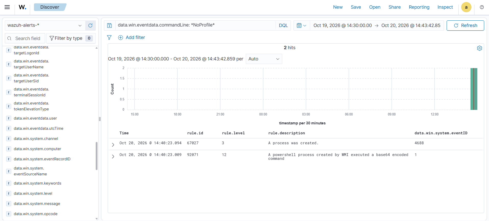

#### 3. #18: Invoke Known Malicious Cmdlets (bloqueado pelo Defender)

O teste define funções falsas com 35 nomes ofensivos (Invoke-Mimikatz, PowerUp, PowerView, Invoke-Shellcode, Set-MasterBootRecord…) e as chama — nada real é baixado ou executado.

| Campo | Conteúdo |
|---|---|
| Resultado | **Prevenção.** O Defender barrou o processo filho (`Access is denied`) antes de o script rodar |
| Ameaça identificada | `Trojan:PowerShell/Mimikatz.A`, via detecção de `CmdLine`, `ActionSuccess: True` |
| 4104 | Não existe: o script nunca chegou a executar |

Na primeira execução o Wazuh **não viu nada** disso, mesmo com o agente `Active`. Diagnóstico:

1. Busca por `providerName: "Microsoft-Windows-Windows Defender"` sem resultado.
2. `archives.json` com `logall_json` ligado: contagem zero para os event IDs 1116 e 1117 — o evento não chegava ao Manager.
3. `ossec.log` do agente mostrava `Could not EvtSubscribe() ... returned (15007)` (canal não encontrado) desde os boots anteriores, durante um update do Windows.
4. `Restart-Service WazuhSvc` no agente → canal reassinado.
5. Teste limpo com **EICAR** (string de teste padrão antimalware) confirmou a correção: 1116 e 1117 chegaram e geraram alerta.

Reexecutei o #18 com o canal corrigido:

| Item | Valor |
|---|---|
| Defender (1116) | `Trojan:PowerShell/Mimikatz.A`, severidade Severe, categoria Trojan, `process Name: Unknown` |
| Wazuh | **62123, level 12** (1116) e **62124, level 3** (1117) — regras padrão, sem necessidade de regra customizada |
| Latência evento → alerta | **~20 s**, medida pelo `systemTime` UTC do próprio evento |
| 4688 | Alerta genérico (**67027, level 3**) com `malcmdlets` na linha de comando |

Essa foi uma lacuna de **coleta**, não de regra: o ruleset padrão já cobre o Defender (1116 em level 12); o problema era o canal do agente estar quebrado. O alerta do Defender não identifica quem lançou o comando (`process Name: Unknown`) — o analista precisa cruzar com o 4688/Sysmon pelo horário.

### Dia 5: Persistência, credenciais, brute force — e um padrão de infraestrutura

#### 1. Lições de infraestrutura acumuladas

| Problema | Causa | Correção / lição |
|---|---|---|
| Lab lento, VMs travando | HDD do host a 97% de uso (I/O wait), RAM do host a 70–91% | CPU baixa + lentidão = gargalo de disco ou memória, não de processamento |
| SSD com só 25 GB livres | Pasta da VM Ubuntu com 104 GB: ~100 GB eram snapshots (VDI diferencial) de uma VM que grava muito (Wazuh Indexer) | Snapshot de VM write-heavy incha o disco do host. Política: no máximo 1 snapshot no Ubuntu |
| Recuperar espaço | Clone completo da VM ("Estado Atual", sem snapshots) = 45 GB reais | Original excluída, clone movido para o SSD |
| Mover interrompido (PC desligou) | Mover copia antes de apagar a origem: a VM continuou íntegra no disco original, sobrou uma cópia órfã de 47 GB | Só apagar arquivo que o VirtualBox não registra. Notebook na tomada |
| Dashboard "Server APIs Offline" / timeout 20 s | Load average alto logo após o boot (Manager, Indexer, Dashboard disputando o HDD) | API respondia (HTTP 401 em 0,7 s). Esperar a carga baixar antes de desistir |
| Manager `failed` ao subir | Duas tentativas de start se atropelaram; sobrou um diretório de lock com um PID antigo | O PID guardado tinha sido reaproveitado por outro processo (`rsyslogd`): a trava era velha. Só removi depois de provar que o PID original estava morto |
| Windows "Getting Windows ready" repetido (até travamentos de horas) | Update pendente sendo aplicado no desligamento, VM engasgando | Desativei o Windows Update de forma durável via política de registro (`HKLM\...\WindowsUpdate\AU\NoAutoUpdate=1` + serviços `wuauserv`/`UsoSvc` desabilitados). VM de lab isolada não precisa de patches num ambiente descartável |
| Apagar snapshot dá medo | "Excluir Instantâneo" mescla o diferencial: perde o ponto de retorno, não o estado atual | Manter snapshots nomeados por fase do lab (antes do Atomic Red Team, antes de cada técnica nova) |

Frase de entrevista: "Descobri o gargalo medindo, não adivinhando: CPU baixa com lentidão apontou para I/O, e o Gerenciador de Tarefas confirmou HDD a 97%."

#### 2. Padrão recorrente: reinício forçado quebra o canal do Defender

O problema do canal do Defender (item anterior, #18) não foi um evento isolado. Depois de um segundo reinício forçado da VM Windows (corte de energia após um travamento de ~3h em update), o mesmo erro `EvtSubscribe ... 15007` voltou a aparecer no canal do Defender. Um teste de T1003.001 (ProcDump, abaixo) foi bloqueado pelo Defender nesse período e **não chegou ao Wazuh** por causa disso — só percebi revisando o `ossec.log` depois.

**Lição consolidada:** todo reinício forçado ou corte de energia da VM Windows deve ser seguido de uma checagem do canal do Defender (`Select-String ... "Defender"` no `ossec.log`) antes de confiar em qualquer teste que dependa dele. Virou item de checklist pós-boot. Fix de novo: `Restart-Service WazuhSvc`, confirmado com um EICAR novo (62123/62124 disparando normalmente).

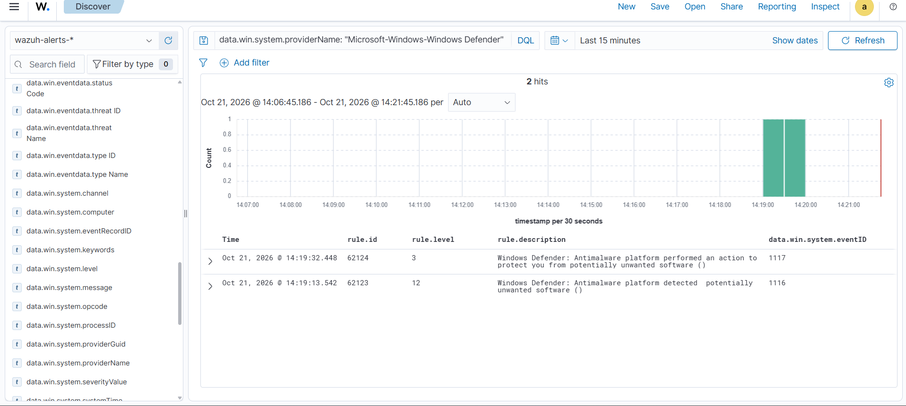

Isso reforça o achado do Dia 4: **agente `Active` no Dashboard não garante que cada canal individual esteja entregando eventos.** É preciso validar por canal (`ossec.log`, `archives.json`), não só pelo status geral do agente.

#### 3. T1547.001: persistência via Registry Run Key

| Campo | Conteúdo |
|---|---|
| Teste | `REG ADD "HKCU\SOFTWARE\Microsoft\Windows\CurrentVersion\Run" /V "Atomic Red Team" /t REG_SZ /F /D "C:\Path\AtomicRedTeam.exe"` (arquivo inexistente, nada executa; cleanup: `REG DELETE`) |
| Por que este teste | Mexe só em HKCU, cria um valor novo, não pede admin, e tem cleanup — critério de risco pelo comando, não pelo nome do teste |
| Hipótese (antes do Wazuh) | `reg add` na chave Run gera Sysmon 13 + Sysmon 1 + 4688; o ruleset padrão deve cobrir autostart |
| Verdade local | `reg query` mostra o valor; Sysmon 13 e dois Sysmon 1 no mesmo segundo |
| Detecção no Wazuh | Sysmon 13 → **92302, level 6** (T1547.001, Persistence/Privilege Escalation); Sysmon 1 → **92041, level 10** ("Value added to registry key has Base64-like pattern") e **92052, level 4** (cmd por processo anormal); 4688 → **67027, level 3** (x2) |
| Veredito | **Detectado.** Hipótese confirmada; verdadeiro positivo de atividade de teste conhecida |
| Ação recomendada | Verificar valor e caminho (arquivo existe? assinatura?), usuário e processo pai, remover a chave, procurar outras chaves Run/RunOnce e tarefas agendadas no host |

O Sysmon marca o evento como `RuleName: T1060,RunKey` (ID antigo do ATT&CK, absorvido por T1547.001); o Wazuh já mapeia para T1547.001 — sinal de que fontes de log diferentes podem carregar nomenclaturas de épocas diferentes do framework.

A regra de maior nível (92041, level 10) não foi a que melhor descreveu o ataque: ela casou por heurística de "parece Base64" num caminho de arquivo comum, enquanto a 92302 (level 6) é que de fato descreveu a persistência. **Nível alto é prioridade, não prova** — a evidência precisa ser lida antes de aceitar a severidade.

Latência medida (Sysmon → alerta): ~63 s, usando `systemTime` UTC do evento.

#### 4. T1003.001: dump de LSASS com ProcDump (bloqueado)

| Campo | Conteúdo |
|---|---|
| Teste | ProcDump (Sysinternals, baixado oficialmente) tenta `procdump.exe -accepteula -ma lsass.exe C:\Windows\Temp\lsass_dump.dmp`. Cleanup: apaga o `.dmp` |
| Hipótese (antes do Wazuh) | Defender deve bloquear antes do dump terminar, como no #18 |
| Resultado | **Prevenção.** `Access is denied` em segundos — mesmo padrão de bloqueio do #18 |
| Defender | **HackTool:Win32/DumpLsass.E** — assinatura específica para ferramentas de dump de LSASS, diferente do rótulo genérico do Mimikatz no #18, via detecção de `CmdLine` |
| Wazuh (1ª tentativa) | Nada chegou — canal do Defender quebrado por reinício forçado (ver item 2 acima) |
| Wazuh (confirmado depois do fix) | **62123, level 12** / **62124, level 3**, mesmo padrão do #18 |
| Veredito | **Prevenido.** Hipótese confirmada; cobertura do SIEM para esse bloqueio específico foi interrompida por uma falha de infraestrutura já identificada e corrigida |

Esse caso amarra as duas lições do dia: o Defender identificou a ferramenta corretamente (`HackTool:Win32/DumpLsass.E`, mais específico que o rótulo genérico do #18), mas o Wazuh só viu o bloqueio depois que o canal foi restaurado — mesma causa raiz do item 2, agora com remédio padronizado (restart do agente + checagem pós-boot).

#### 5. T1110: SSH Brute Force — detecção em camadas (ruleset padrão)

| Campo | Conteúdo |
|---|---|
| Setup | Kali (192.168.56.103) → Hydra contra o Ubuntu Manager (192.168.56.101), usuário de teste descartável `testattack` criado só para o exercício |
| Wordlist | 10 senhas reais do início da `rockyou.txt` + `senha123` no final (senha correta de propósito) |
| Comando | `hydra -l testattack -P /tmp/passlist.txt ssh://192.168.56.101 -t 1 -W 2` |
| Hipótese (antes do Wazuh) | Esperava múltiplas falhas + 1 sucesso gerando regra de brute force padrão |
| `auth.log` (verdade local) | A 1ª sessão SSH atingiu `MaxAuthTries` e foi desconectada pelo próprio sshd (`Too many authentication failures [preauth]`) — defesa nativa, independente do Wazuh. Hydra reconectou; mais falhas; depois `Accepted password` |
| **Detecção no Wazuh — 7 regras em cadeia** | 5760 (nv5, sshd auth failed) → **5763 (nv10, "sshd: brute force trying to get access to the system")** → 5503 x2 (nv5, PAM login failed) → 2501 (nv5, syslog auth failure) → 2502 (nv10, "User missed the password more than one time") → 5758 (nv8, "Maximum authentication attempts exceeded" — bate com o `MaxAuthTries` do `auth.log`) → **40112 (nv12, "Multiple authentication failures followed by a success")** |
| Veredito | **Detectado em múltiplas camadas.** Hipótese confirmada e superada — ruleset padrão não exigiu regra customizada |
| Ação recomendada | Bloquear IP de origem, forçar troca de senha de `testattack`, revisar se há MFA disponível, revisar política de `MaxAuthTries`/fail2ban |

Detalhe do alerta final (40112): `data.dstuser: testattack`, `data.srcip: 192.168.56.103`, `rule.mitre.id: T1078, T1110` (Brute Force **e** Valid Accounts — após adivinhar a senha, o atacante tem credencial válida), 5 táticas MITRE envolvidas (Defense Evasion, Persistence, Privilege Escalation, Initial Access, Credential Access), `rule.frequency: 2` (regra de correlação, mesmo princípio da nossa 100014). O Manager também é monitorado como agente de si mesmo (`agent.id: 000`), via `<localfile>` do próprio `auth.log`.

Observações adicionais: o `message repeated N times` do syslog comprime linhas repetidas, então contar tentativas manualmente por linha de log pode subestimar o total. A conta real (`wazuh-admin`) nunca foi atacada — usei uma conta descartável como boa prática de lab. Este foi o caso mais rico do lab: 7 regras padrão cobrindo o mesmo ataque em camadas, sem precisar de regra customizada.

## Mapeamento MITRE ATT&CK

| Técnica | ID | Evento (Windows/Linux) | Regra Wazuh | Situação |
|---|---|---|---|---|
| Account Discovery | T1087 | Sysmon 1 (`net.exe`/`net1.exe`) | 92031, 92033 | Detectada |
| Command and Scripting Interpreter: PowerShell | T1059.001 | Sysmon 1, Security 4688, PowerShell 4104 | 92033, 92201, 92071, 67027 | Detectada |
| System Owner/User Discovery | T1033 | Sysmon 1 (`whoami.exe`) | 100010 (customizada) | Lacuna fechada |
| System Network Configuration Discovery | T1016 | Sysmon 1 (`ipconfig.exe`) | 100011 (customizada) | Lacuna fechada |
| System Information Discovery | T1082 | Sysmon 1 (`systeminfo.exe`) | 100012 (customizada) | Lacuna fechada |
| Ingress Tool Transfer | T1105 | Sysmon 11 (file create) | 92213 | Falso positivo tratado com tuning (100013) |
| Windows Management Instrumentation | T1047 | Sysmon 1 (processo pai `WmiPrvSE.exe`) | 92071 (exercitada junto com T1059.001 #15) | Detectada |
| Persistence: Registry Run Keys | T1547.001 | Sysmon 13 (registry value set), Sysmon 1, Security 4688 | 92302, 92041, 92052 | Detectada |
| OS Credential Dumping: LSASS Memory | T1003.001 | Defender 1116/1117 (HackTool:Win32/DumpLsass.E) | 62123, 62124 | Prevenida; lacuna de coleta identificada e corrigida (canal do Defender) |
| Brute Force | T1110 | `auth.log` (sshd, PAM) | 5760, 5763, 5503, 2501, 2502, 5758, 40112 | Detectada em camadas |
| Valid Accounts | T1078 | `auth.log` (`Accepted password`) | 40112 (mapeamento duplo com T1110) | Detectada |
| Impair Defenses (exclusão do Defender) | T1562.001 | Defender 5007 (config alterada) | sem regra específica na época | Identificada; não alertada por falha de coleta na época |

## Principais aprendizados

- Baixa utilização de CPU com lentidão extrema aponta para espera de I/O ou falta de memória, e não para falta de processamento — o mesmo padrão se repetiu três vezes no lab (instalação do Windows, start do Indexer, travamentos de update).
- Coleta e detecção são coisas diferentes, e cada uma quebra de um jeito distinto. Um evento pode: (a) não ser gerado pela fonte, (b) ser gerado mas não chegar ao Manager, ou (c) chegar e não casar com regra. Separar essas três hipóteses evita diagnosticar "falta regra" quando na verdade é um canal quebrado — e foi exatamente isso que aconteceu com o Defender duas vezes no lab.
- Agente `Active` no Dashboard não garante que todo canal individual esteja entregando eventos. Reinícios forçados da VM Windows quebraram repetidamente a assinatura do canal do Defender (`EvtSubscribe ... 15007`), e o status geral do agente não mostrava isso.
- O índice `wazuh-alerts-*` só guarda eventos que casaram com alguma regra de nível ≥ 3; para provar que um evento chegou sem gerar alerta, é preciso o `logall_json`/`archives.json`, não só o Discover.
- Alerta de nível mais alto não é prova de melhor entendimento do ataque: uma regra heurística (nível 10) casou por "parece Base64" num caminho comum, enquanto a regra que de fato descrevia a técnica (T1547.001) tinha nível 6.
- Escrever a hipótese antes de olhar o SIEM é o que separa "eu sabia que ia detectar" de um teste real: em pelo menos um caso a hipótese foi refutada (o `-E` abreviado não escapou da regra 92071).
- Latência evento → alerta varia por fonte: medi de ~20 s (Defender) a ~63 s (Sysmon/registro), sempre usando o `systemTime` UTC do próprio evento em vez do relógio local da VM (que estava 4h a menos que o Dashboard).
- O analista também deixa rastro: o `sudo` registra a linha de comando digitada (regra 5402) e os próprios comandos de verificação geram 4104 — o que o analista digita também vira evidência.
- Regras customizadas precisam de IDs que não colidam com os de exemplo do `local_rules.xml`, só valem depois de reiniciar o Manager, e o `frequency` não conta exatamente como o número escrito (testar com N-1 e N eventos revela o comportamento real).
- Um alerta de nível 15 pode ser falso positivo. Triagem é olhar quem, o quê, onde, quando e se repete, e só então propor o tuning.
- Um ataque pode exercitar mais de uma técnica sem planejamento: o teste #15 do Atomic Red Team lança o PowerShell via WMI, então um teste "de PowerShell" também é um teste de T1047.
- O ruleset padrão do Wazuh, sem nenhuma regra customizada, foi suficiente para detectar em camadas um ataque completo de SSH brute force (7 regras encadeadas) — nem toda lacuna exige engenharia de detecção; muitas vezes o trabalho é confirmar que a cobertura pronta já funciona.

## Limitações conhecidas

- A regra **92201** (level 9) também dispara para o padrão `__PSScriptPolicyTest_*.ps1`, o mesmo comportamento benigno que a 100013 trata — mas a 100013 só cobre a 92213. Falta uma regra de tuning irmã para a 92201 (e checar antes quem é o processo SYSTEM que aparece nela).
- A triagem de alertas ainda cobre só 1 caso (92213). Mais alertas do ambiente, incluindo falsos positivos de outras naturezas, continuam sem revisão formal.

## Referências

- [Documentação do Wazuh](https://documentation.wazuh.com/)
- [Sysmon (Sysinternals)](https://learn.microsoft.com/sysinternals/downloads/sysmon)
- [SwiftOnSecurity sysmon-config](https://github.com/SwiftOnSecurity/sysmon-config)
- [Atomic Red Team (Red Canary)](https://github.com/redcanaryco/atomic-red-team)
- [MITRE ATT&CK](https://attack.mitre.org/)
